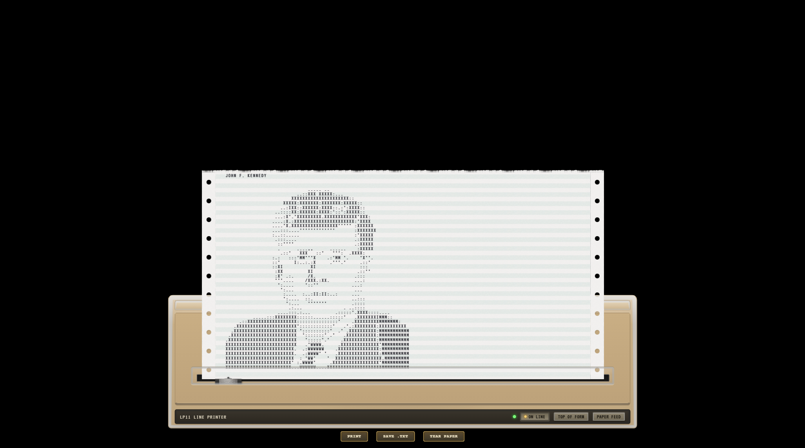

# John F. Kennedy

A self-contained, ready-to-load yaPDP saved state prepared to print an image of John F. Kennedy.

[▶ **Launch this demonstration in yaPDP**](https://amesk.github.io/yaPDP/pdp11.html?state=https%3A%2F%2Fraw.githubusercontent.com%2Famesk%2FyaPDP-goodies%2Fmaster%2Fstates%2Fkennedy%2Fkennedy.state.zst)

The state was restored and verified independently: **it contains everything needed for this demonstration. No separate disk image from the `media/` collection is required.**

## Files

- **[`kennedy.state.zst`](kennedy.state.zst)** — the Zstandard-compressed saved emulator state.
- **[`preview.png`](preview.png)** — a screenshot preview of the demonstration.

## Load directly in yaPDP

The launch link above opens the public yaPDP application and passes the state URL automatically. To load the state manually, use this direct file URL:

[`kennedy.state.zst`](https://raw.githubusercontent.com/amesk/yaPDP-goodies/master/states/kennedy/kennedy.state.zst)

For URL-based loading, use `raw.githubusercontent.com` URLs for browser `fetch()` requests; GitHub's `github.com/.../raw/...` page URLs may fail due to CORS.

## What to expect

Load the saved state in yaPDP to resume the prepared session. The demonstration is intended to show the emulator's printing workflow and the resulting image.

## Format

The state file is compressed with Zstandard.
