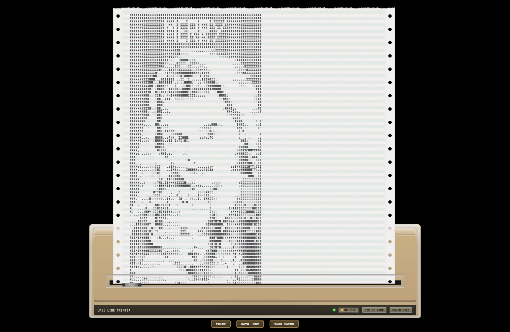

# Madonna and Child

A ready-to-load yaPDP saved state prepared to print an image of Madonna and Child.

## Files

- **[`madonna.state.zst`](madonna.state.zst)** — the Zstandard-compressed saved emulator state.
- **[`preview.png`](preview.png)** — a screenshot preview of the demonstration.
- **[`print.pdf`](print.pdf)** — the accompanying PDF printout.

## What to expect

Load the saved state in yaPDP to resume the prepared session. The demonstration is intended to show the emulator's printing workflow and the resulting image.

## Related media

The [RT-11 ASCII Art disk image](../../media/rt-11-ascii-art/README.md) is published separately in this repository. Its RT-11 directory includes a file named `MADONN.ART`. The disk image and this saved state are separate downloads; consult the emulator's restored device configuration when determining which media are required for a particular run.

## Format

The state file is compressed with Zstandard. If the yaPDP version or loading workflow you use does not accept the compressed file directly, decompress it first with a Zstandard-compatible utility.
